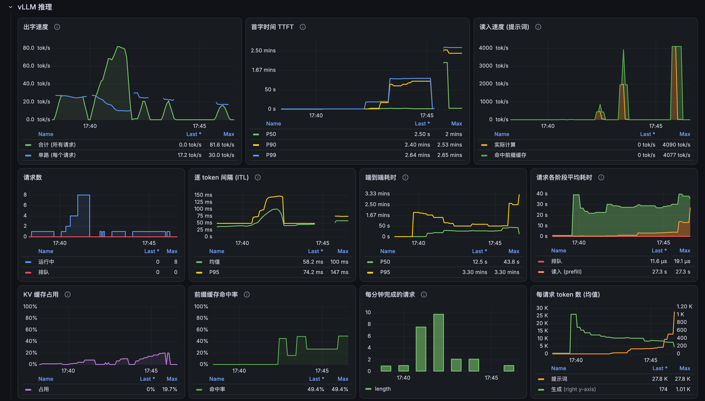

# 新款 MacBook Pro（M5 Max，128GB）本地大模型压测报告

测试日期：2026-11-14

网页版：https://doge-rgb.github.io/laptops/

## 一、最终状态

### 环境

| 项目 | 内容 |
|---|---|
| 机器 | 新款 MacBook Pro，Apple M5 Max（18 核 CPU，40 核 GPU），128GB 内存 |
| 系统 | macOS 27.2.1，接电源 |
| 推理服务 | vLLM 0.33.0 + vllm-metal 0.33.0 |
| 模型 | [orcarouter/Qwen3.8-27B-Uncensored-MLX](https://huggingface.co/orcarouter/Qwen3.8-27B-Uncensored-MLX)，4-bit 量化，权重 15GB |
| 服务参数 | 上下文上限 131072 token，KV 缓存 20GB |
| 压测方式 | 流式接口，关闭思考，每路生成固定数量的 token |
| 监控 | Prometheus + Grafana，硬件数据来自 macmon |

### 出字速度

| 并发路数 | 每路速度 | 合计速度 | 首字时间 |
|---|---|---|---|
| 1 | 26.8 tok/s | 26.9 tok/s | 0.15 秒 |
| 2 | 22.7 tok/s | 45.4 tok/s | 0.38 秒 |
| 4 | 17.1 tok/s | 68.2 tok/s | 0.47 秒 |
| 8 | 10.1 tok/s | 80.6 tok/s | 0.68 秒 |

单路连续生成 2000 token，平均 25.8 tok/s。

同一模型的 8-bit 版本单路出字 16.4 tok/s。

### 长上下文

| 上下文长度 | 首次读入耗时 | 读入速度 | 读完后的出字速度 | 再次提问的首字时间 |
|---|---|---|---|---|
| 7,580 token | 12.0 秒 | 634 tok/s | 24.5 tok/s | 1.25 秒 |
| 29,306 token | 48.6 秒 | 603 tok/s | 22.7 tok/s | 0.99 秒 |
| 61,348 token | 126.8 秒 | 484 tok/s | 17.2 tok/s | 1.34 秒 |

### 硬件

| 项目 | 压测期间 |
|---|---|
| 整机功耗 | 平均 67 W，峰值 96 W |
| GPU 利用率 | 平均 85%，单路生成阶段 93% |
| GPU 温度 | 最高 94 °C |
| CPU 温度 | 最高 88 °C |
| 风扇转速 | 最高 5790 rpm |
| 内存 | 已用最高 61 GB，内存压力最高 35%，没有使用交换 |
| KV 缓存 | 最高占用 19.7% |

## 二、截图

压测期间的推理指标：

压测期间的硬件指标：

## 三、量化格式对比

同一份 BF16 原始权重（[orcarouter/Qwen3.8-27B-Uncensored](https://huggingface.co/orcarouter/Qwen3.8-27B-Uncensored)），用 MLX 0.32.4 分别转成 4-bit 整数和 NVFP4 两种格式。量化的层相同，只量化权重，直接取最近值，没有校准。两种格式折合都是每权重 4.5 位。

### 精度

对照 BF16 原始权重，在 12,288 个位置上比较输出，英文、中文、代码各占三分之一。

| 格式 | 位数 | KL 散度 | 首选词一致率 | 困惑度变化 |
|---|---|---|---|---|
| MLX 8-bit 整数（参照） | 8.6 | 0.0014 | 98.7% | +0.06% |
| MLX 4-bit 整数 | 4.5 | 0.079 | 89.8% | +5.7% |
| 标准 NVFP4 | 4.5 | 0.081 | 89.8% | +5.7% |
| MLX 的 NVFP4 模式 | 4.5 | 0.106 | 88.2% | +7.3% |

标准 NVFP4 按公开定义实现：4 位浮点，16 个一组，每组一个 8 位缩放，每个张量一个 32 位缩放。量化后还原成 16 位权重再评测。用同样的做法复现 MLX 的两种模式，结果与真实量化包一致。

MLX 0.32.4 的 NVFP4 模式对普通线性层没有每个张量的缩放。三者的权重误差分别是：MLX 4-bit 整数 9.3%，标准 NVFP4 9.5%，MLX 的 NVFP4 模式 11.3%。

### 速度

用 vLLM 以相同参数交替各测两轮。测试时没有其他程序占用 GPU，数字比第一节略高。

| 项目 | MLX 4-bit 整数 | MLX 的 NVFP4 模式 |
|---|---|---|
| 单路出字 | 27.3–28.0 tok/s | 26.8–28.6 tok/s |
| 4 路合计 | 70–72 tok/s | 74–75 tok/s |
| 读入 8 千 token | 684–698 tok/s | 666–679 tok/s |
| 8 千上下文下出字 | 25.8–26.0 tok/s | 24.6–25.3 tok/s |
| 内存占用 | 35 GB | 35 GB |

## 四、结论

1. 单路出字 26–27 tok/s，连续生成 2000 token 平均 25.8 tok/s。
2. 并发总吞吐上限约 80 tok/s。4 路以内每路在 17 tok/s 以上，8 路时每路降到 10 tok/s。
3. 首字时间取决于要读入多少 token。读入速度 480–630 tok/s：8 千 token 等 12 秒，3 万等 49 秒，6 万等 127 秒。
4. 同一段上下文再次提问会命中缓存，首字时间 1–1.3 秒。
5. 上下文越长出字越慢：8 千 token 时 24.5 tok/s，6 万 token 时 17.2 tok/s。
6. 满载时整机 85–96 W，GPU 最高 94 °C，风扇 5800 rpm。128GB 内存够用，全程没有交换。
7. 其他程序占用 GPU 时速度会下降。测试当天 macOS 后台照片分析运行期间，单路速度为 18–24 tok/s。
8. 同样 4.5 位，MLX 4-bit 整数和标准 NVFP4 精度相同，作为权重格式是等价的。
9. MLX 的 NVFP4 模式精度更差，在这台机器上用 4-bit 整数格式。
10. 两种格式的速度相差在几个百分点以内。
11. 8-bit 几乎无损，首选词一致率 98.7%，单路出字约 16 tok/s。4-bit 的首选词一致率是 89.8%，单路出字 27 tok/s。
12. 这次只比较了权重格式。N 卡上的 NVFP4 通常连激活值一起量化，不在对比范围内。
