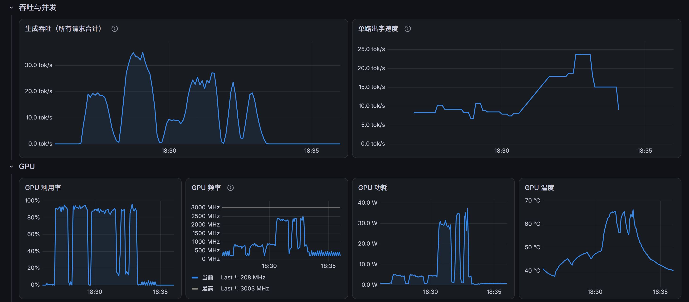
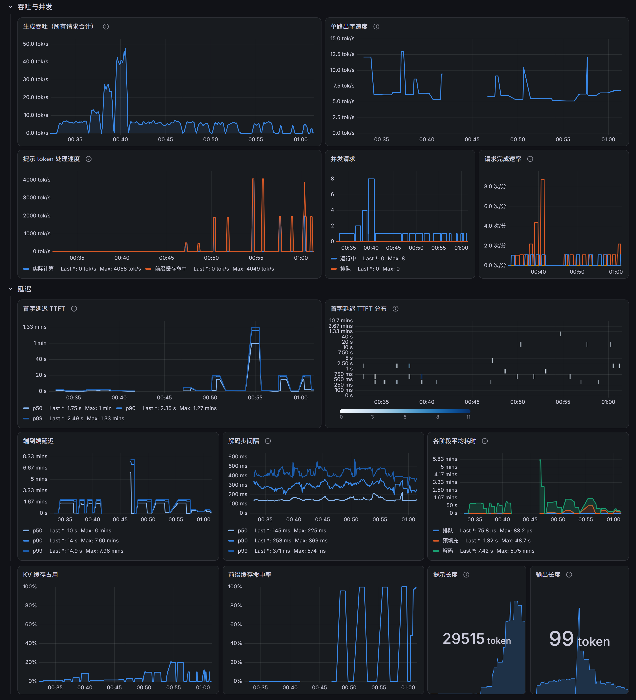

# 本地大模型压测对比：MacBook Pro M5 Max 128GB 与 ASUS ProArt 16 RTX Spark 128GB

测试日期：2026-11-14

网页版：https://doge-rgb.github.io/laptops/

## 一、结论

1. ASUS 的速度由屏幕状态决定。亮屏时 GPU 在 P0，单路 22.7 tok/s；熄屏进入 Modern Standby 后 GPU 停在 P8，单路 11.5 tok/s。
2. 单路出字：MacBook 26.8 tok/s，ASUS 亮屏 22.7 tok/s。8 路合计：MacBook 80.6 tok/s，ASUS 亮屏 114.9 tok/s。
3. 读入长上下文 ASUS 亮屏更快（tok/s，ASUS 对 MacBook）：8 千 token 1,589 对 634，3 万 token 1,367 对 603，6 万 token 1,136 对 484。熄屏时为 398–503。
4. 同一段上下文再次提问，两台机器都命中前缀缓存，首字时间 0.4–3 秒。ASUS 的缓存按 832 token 整页复用，对不齐时整段重读。
5. 满载时 MacBook 整机 67–96 W、GPU 94 °C；ASUS 亮屏 GPU 28–42 W、67 °C，熄屏 GPU 4–8 W。
6. ASUS 的 KV 缓存设为 12GB，同时运行上限 8 路（占用 90.1%），第 9 路排队；MacBook 设 20GB，8 路时占用 19.7%。
7. 量化格式：同为每权重 4.5 位，MLX 4-bit 整数与标准 NVFP4 精度相同（首选词一致率 89.8%），速度相差几个百分点；MLX 自带的 NVFP4 模式精度更差（88.2%）。8-bit 几乎无损（98.7%），MacBook 上单路 16.4 tok/s。

## 二、环境

| 项目 | MacBook Pro M5 Max | ASUS ProArt 16 RTX Spark |
|---|---|---|
| 硬件 | Apple M5 Max（18 核 CPU，40 核 GPU），128GB 统一内存 | NVIDIA RTX Spark N1X（20 核 CPU，Blackwell GPU），128GB：系统内存 64GB + 显存 64GB |
| 系统 | macOS 27.2.1，接电源 | Windows 11 ARM64 + WSL2，接电源，电源方案 Standard |
| 推理服务 | vLLM 0.33.0 + vllm-metal 0.33.0 | vLLM 0.33.0（CUDA，运行在 WSL2 内） |
| 模型 | [orcarouter/Qwen3.8-27B-Uncensored-MLX](https://huggingface.co/orcarouter/Qwen3.8-27B-Uncensored-MLX)，4-bit 量化，权重 15GB | [orcarouter/Qwen3.8-27B-Uncensored-NVFP4](https://huggingface.co/orcarouter/Qwen3.8-27B-Uncensored-NVFP4)，NVFP4 量化，权重占显存 21.5 GiB；草稿模型 [incoai/Qwen3.8-27B-DFlash2](https://huggingface.co/incoai/Qwen3.8-27B-DFlash2) 做推测解码，每步 7 个草稿 token |
| 服务参数 | 上下文上限 131072 token，KV 缓存 20GB | 上下文上限 131072 token，KV 缓存 12GB |
| 压测方式 | 流式接口，关闭思考，每路生成固定数量的 token | 流式接口，关闭思考，每路 512 token |
| 监控 | Prometheus + Grafana，硬件数据来自 macmon | Prometheus + Grafana，硬件数据来自 nvidia-smi 和 Windows 性能计数器 |

## 三、出字速度

单位 tok/s，合计为各路速度之和。ASUS 分亮屏和熄屏两种状态，原因见第七节。

| 并发 | MacBook 每路 | MacBook 合计 | ASUS 亮屏 每路 | ASUS 亮屏 合计 | ASUS 熄屏 每路 | ASUS 熄屏 合计 |
|---|---|---|---|---|---|---|
| 1 | 26.8 | 26.9 | 22.7 | 22.7 | 11.5 | 11.5 |
| 2 | 22.7 | 45.4 | 20.7 | 41.4 | 9.3 | 18.6 |
| 4 | 17.1 | 68.2 | 19.2 | 76.9 | 8.6 | 34.5 |
| 8 | 10.1 | 80.6 | 14.4 | 114.9 | 6.5 | 52.3 |

单路连续生成 2000 token：MacBook 25.8 tok/s，ASUS 亮屏 19.4 tok/s，熄屏 10.8 tok/s。

MacBook 上同一模型的 8-bit 版本单路出字 16.4 tok/s。ASUS 不开推测解码时，熄屏状态单路为 3.8 tok/s。

### 首字时间

| 并发 | MacBook | ASUS 亮屏 | ASUS 熄屏 |
|---|---|---|---|
| 1 | 0.15 秒 | 0.39 秒 | 0.67 秒 |
| 2 | 0.38 秒 | 0.58 秒 | 0.88 秒 |
| 4 | 0.47 秒 | 0.58 秒 | 1.19 秒 |
| 8 | 0.68 秒 | 0.72 秒 | 2.50 秒 |

## 四、长上下文

| 上下文 | 机器 | 首次读入耗时 | 读入速度 | 读完后的出字速度 | 再次提问的首字时间 |
|---|---|---|---|---|---|
| 约 8 千 | MacBook（7,580 token） | 12.0 秒 | 634 tok/s | 24.5 tok/s | 1.25 秒 |
|  | ASUS 亮屏（7,550 token） | 4.8 秒 | 1,589 tok/s | 23.4 tok/s | 0.45 秒 |
|  | ASUS 熄屏（7,550 token） | 15.0 秒 | 503 tok/s | 10.8 tok/s | 0.64 秒 |
| 约 3 万 | MacBook（29,306 token） | 48.6 秒 | 603 tok/s | 22.7 tok/s | 0.99 秒 |
|  | ASUS 亮屏（28,373 token） | 20.8 秒 | 1,367 tok/s | 21.4 tok/s | 0.69 秒 |
|  | ASUS 熄屏（28,373 token） | 57.4 秒 | 495 tok/s | 12.1 tok/s | 0.88 秒 |
| 约 6 万 | MacBook（61,348 token） | 126.8 秒 | 484 tok/s | 17.2 tok/s | 1.34 秒 |
|  | ASUS 亮屏（59,161 token） | 52.1 秒 | 1,136 tok/s | 20.3 tok/s | 0.92 秒 |
|  | ASUS 熄屏（59,809 token） | 150.2 秒 | 398 tok/s | 9.1 tok/s | 3.07 秒 |

## 五、硬件状态

| 项目 | MacBook Pro M5 Max | ASUS 亮屏 | ASUS 熄屏 |
|---|---|---|---|
| GPU 性能状态 | 未采集 | P0，2.0–2.4 GHz | P8，0.7–0.8 GHz |
| 功耗 | 整机平均 67 W，峰值 96 W | GPU 28–42 W，峰值 55 W | GPU 4–8 W，峰值 9 W |
| GPU 利用率 | 平均 85%，单路生成阶段 93% | 68–94% | 84–92% |
| GPU 温度 | 最高 94 °C | 最高 67 °C | 最高 52 °C |
| CPU | 温度最高 88 °C | 占用 15–24% | 占用 9–15% |
| 风扇 | 最高 5790 rpm | 未采集 | 未采集 |
| 内存 | 已用最高 61 GB，没有使用交换 | 系统内存 25 GiB，显存 43 GiB | 系统内存 28 GiB，显存 43 GiB |
| KV 缓存占用 | 最高 19.7%（20GB） | 最高 90.1%（12GB） | 最高 90.1%（12GB） |

ASUS 的 GPU 上限频率 3.0 GHz；功耗为 nvidia-smi 读数，整机功耗没有可用的传感器。

## 六、量化格式对比

在 MacBook 上做。同一份 BF16 原始权重（[orcarouter/Qwen3.8-27B-Uncensored](https://huggingface.co/orcarouter/Qwen3.8-27B-Uncensored)），用 MLX 0.32.4 分别转成 4-bit 整数和 NVFP4 两种格式。量化的层相同，只量化权重，直接取最近值，没有校准。两种格式折合都是每权重 4.5 位。

### 精度

对照 BF16 原始权重，在 12,288 个位置上比较输出，英文、中文、代码各占三分之一。

| 格式 | 位数 | KL 散度 | 首选词一致率 | 困惑度变化 |
|---|---|---|---|---|
| MLX 8-bit 整数（参照） | 8.6 | 0.0014 | 98.7% | +0.06% |
| MLX 4-bit 整数 | 4.5 | 0.079 | 89.8% | +5.7% |
| 标准 NVFP4 | 4.5 | 0.081 | 89.8% | +5.7% |
| MLX 的 NVFP4 模式 | 4.5 | 0.106 | 88.2% | +7.3% |

标准 NVFP4 按公开定义实现：4 位浮点，16 个一组，每组一个 8 位缩放，每个张量一个 32 位缩放。量化后还原成 16 位权重再评测。用同样的做法复现 MLX 的两种模式，结果与真实量化包一致。

MLX 0.32.4 的 NVFP4 模式对普通线性层没有每个张量的缩放。三者的权重误差分别是：MLX 4-bit 整数 9.3%，标准 NVFP4 9.5%，MLX 的 NVFP4 模式 11.3%。

### 速度

用 vLLM 以相同参数交替各测两轮。测试时没有其他程序占用 GPU，数字比第三、四节的 MacBook 数据略高。

| 项目 | MLX 4-bit 整数 | MLX 的 NVFP4 模式 |
|---|---|---|
| 单路出字 | 27.3–28.0 tok/s | 26.8–28.6 tok/s |
| 4 路合计 | 70–72 tok/s | 74–75 tok/s |
| 读入 8 千 token | 684–698 tok/s | 666–679 tok/s |
| 8 千上下文下出字 | 25.8–26.0 tok/s | 24.6–25.3 tok/s |
| 内存占用 | 35 GB | 35 GB |

这里只比较了权重格式。N 卡上的 NVFP4 通常连激活值一起量化，不在对比范围内。

## 七、ASUS 瓶颈分析

### 1. 熄屏后 GPU 被压在最低性能状态

屏幕因空闲熄灭后系统进入 Modern Standby，GPU 从 P0 掉到 P8，频率从 2.0–2.4 GHz 降到 0.7–0.9 GHz。推理进程照常运行，只是变慢。系统日志里进出待机的时间点与 GPU 状态切换的时间点一致：

| 时间段 | 系统状态 | GPU | 单路解码 |
|---|---|---|---|
| 17:30:45–18:14:29 | Modern Standby（熄屏） | P8，0.7–0.9 GHz，4–8 W，50 °C | 2.9 步/秒，11.5 tok/s |
| 18:30:27–18:32:50 | 亮屏 | P0，2.0–2.4 GHz，25–33 W，66 °C | 6.3 步/秒，22–24 tok/s |
| 18:32:50 之后 | Modern Standby（熄屏） | P8，0.6–0.9 GHz | 回到 3 步/秒 |

同一轮测试里的切换过程：18:30:27 亮屏，GPU 频率从 0.8 GHz 升到 2.3 GHz，功耗从 4 W 升到 30 W，正在生成的那一路从 9 tok/s 升到 22 tok/s；18:32:50 熄屏后回落。

系统温区全程没有触发温控降频，电源接入。处理办法：需要全速时保持亮屏，或把接通电源时的熄屏时间设为从不。

### 2. GPU 微基准

| 测试 | 亮屏 结果 | 亮屏 GPU 频率与功耗 | 熄屏 结果 | 熄屏 GPU 频率与功耗 |
|---|---|---|---|---|
| 显存读 4 GiB | 206.5 GiB/s | 1.52 GHz，9.7 W | 152.1 GiB/s | 0.67 GHz，2.1 W |
| 显存写 4 GiB | 153.4 GiB/s | 2.29 GHz，23.9 W | 112.4 GiB/s | 0.67 GHz，2.7 W |
| 显存拷贝 4 GiB | 100.8 GiB/s | 1.69 GHz，11.1 W | 79.5 GiB/s | 0.94 GHz，2.9 W |
| bfloat16 矩阵乘 4096² | 61.9 TFLOPS | 1.77 GHz，46.8 W | 19.0 TFLOPS | 0.60 GHz，8.4 W |
| float32 矩阵乘 4096² | 12.4 TFLOPS | 1.65 GHz，45.3 W | 3.9 TFLOPS | 0.62 GHz，10.1 W |

### 3. 各环节的限制因素

1. 读入受算力限制。熄屏时 6 万 token 读入 398 tok/s，按每 token 54 GFLOP 折合 21 TFLOPS，与该状态下 bfloat16 矩阵乘实测的 19 TFLOPS 持平。亮屏时为 1,136 tok/s，折合 61 TFLOPS，矩阵乘实测 62 TFLOPS。
2. 解码每步要把 21.5 GiB 权重读一遍。熄屏时显存读取 152 GiB/s，读一遍 0.14 秒，实测每步 0.34 秒。亮屏时读取 206 GiB/s，读一遍 0.10 秒，实测每步 0.16 秒，读权重占每步时间的 65%，再提速要靠内存带宽。
3. 推测解码每步确认 3.3–4.0 个 token（草稿接受率 32%–43%），是单路速度的主要放大器：熄屏状态不开为 3.8 tok/s，开启后 11.5 tok/s。
4. 并发受 KV 缓存限制。模型是注意力层加状态层的混合架构，vLLM 按 832 token 一页分配缓存，每个请求的状态层固定占 12GB 缓存的 11.3%。8 路占 90.1%；10 路实测为 8 路运行、2 路排队。显存还空 19 GiB，可以加大。
5. 前缀缓存只在 832 token 的整页边界上复用，并且只有上一个请求提示末尾那个边界的状态可用。追加式对话都能命中；同一文档换一个问题时，分歧点落在该边界之前就完全不命中：熄屏状态下 3 万 token 文档实测首字 60 秒，命中时 0.8 秒。
6. 内存按 64GB 系统内存 + 64GB 显存固定划分，模型加 KV 缓存不能超过 64GB；MacBook 的 128GB 是统一内存。
7. CPU、温度都有余量：CPU 占用 9–24%，GPU 最高 67 °C，系统温区没有触发温控降频。

## 八、监控截图

MacBook，推理指标：

MacBook，硬件指标：

ASUS，推理指标（亮屏状态，19:45–19:57）：

ASUS，硬件指标（亮屏状态，19:45–19:57）：

