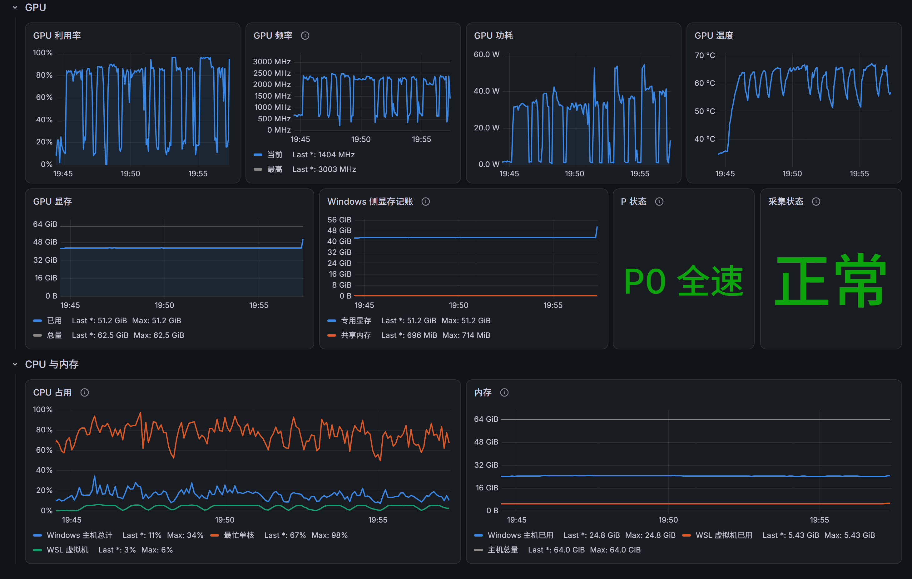

# 本地大模型压测对比：MacBook Pro M5 Max 128GB 与 ASUS ProArt 16 RTX Spark 128GB

测试日期：MacBook 2026-11-14，ASUS 2026-11-15

网页版：https://doge-rgb.github.io/laptops/

## 一、结论

同一模型的 NVFP4 版本，两台机器都没有开推测解码，每路 400 token，亮屏。

| 项目 | MacBook NVFP4 | ASUS NVFP4 | 领先 |
|---|---|---|---|
| 单路出字 | 25.9 tok/s | 6.2 tok/s | MacBook 4.2 倍 |
| 8 路合计 | 78.8 tok/s | 42.7 tok/s | MacBook 1.8 倍 |
| 单路连续 2000 token | 26.5 tok/s | 5.8 tok/s | MacBook 4.6 倍 |
| 短提示首字时间，单路 | 0.40 秒 | 0.44 秒 | MacBook 1.1 倍 |
| 读入约 6 万 token | 144.3 秒（425 tok/s） | 49.1 秒（1,240 tok/s） | ASUS 2.9 倍 |
| 约 6 万上下文下出字 | 15.7 tok/s | 5.1 tok/s | MacBook 3.1 倍 |
| 再次提问的首字时间 | 1.11–1.57 秒 | 0.57–0.87 秒 | ASUS 1.9 倍 |
| GPU 功耗 | 23–31 W | 28–35 W |  |
| GPU 最高温度 | 90 °C | 68 °C |  |
| 运行时内存 | 38 GB | 显存 50 GB |  |

- 出字 MacBook 快。解码每步要把权重读一遍，受内存带宽限制：MacBook 读取实测 440–507 GiB/s，每步读 14.1 GiB；ASUS 读取实测 228 GiB/s，每步读 21.5 GiB。
- 读入 ASUS 快。读入受 GPU 算力限制：bfloat16 矩阵乘实测 ASUS 67 TFLOPS，MacBook 49.7 TFLOPS。
- ASUS 开推测解码后单路 22.7、8 路合计 114.9 tok/s（DFlash2 草稿模型，每路 512 token 时测得）。

## 二、环境

| 项目 | MacBook Pro M5 Max | ASUS ProArt 16 RTX Spark |
|---|---|---|
| 硬件 | 新款 MacBook Pro，Apple M5 Max（18 核 CPU，40 核 GPU），128GB 统一内存 | NVIDIA RTX Spark N1X（20 核 CPU，Blackwell GPU），128GB：系统内存 64GB + 显存 64GB |
| 系统 | macOS 27.2.1，接电源 | Windows 11 ARM64 + WSL2，接电源，电源方案 Standard |
| 推理服务 | vLLM 0.33.0 + vllm-metal 0.33.0 | vLLM 0.33.0（CUDA，运行在 WSL2 内） |
| 模型 | [orcarouter/Qwen3.8-27B-Uncensored](https://huggingface.co/orcarouter/Qwen3.8-27B-Uncensored) 的 BF16 原始权重，以及用 MLX 0.32.4 从它转出的 8-bit、6-bit、4-bit 整数和 NVFP4 四个量化版本。量化的层相同，只量化权重，没有校准。4-bit 和 8-bit 与发布版 [orcarouter/Qwen3.8-27B-Uncensored-MLX](https://huggingface.co/orcarouter/Qwen3.8-27B-Uncensored-MLX) 精度一致 | [orcarouter/Qwen3.8-27B-Uncensored-NVFP4](https://huggingface.co/orcarouter/Qwen3.8-27B-Uncensored-NVFP4)，NVFP4 与 FP8 混合量化，权重占显存 21.5 GiB |
| 服务参数 | 上下文上限 131072 token，KV 缓存 20GB，没有开推测解码 | 上下文上限 131072 token，KV 缓存 20GB，没有开推测解码 |
| 压测方式 | 流式接口，关闭思考，每路 400 token。五种精度依次测试，亮屏，测试期间暂停了系统的后台照片分析 | 流式接口，关闭思考，每路 400 token，亮屏 |
| 监控 | Prometheus + Grafana，硬件数据来自 macmon | Prometheus + Grafana，硬件数据来自 nvidia-smi 和 Windows 性能计数器 |
| 测试日期 | 2026-11-14 | 2026-11-15 |

## 三、模型文件与精度

MacBook 测了同一个模型的五种精度，每种精度一列。ASUS 测的是 NVFP4 版本。后面各表的列相同。

### 模型文件

| 项目 | Mac 4-bit | Mac NVFP4 | Mac 6-bit | Mac 8-bit | Mac BF16 | ASUS NVFP4 |
|---|---|---|---|---|---|---|
| 量化格式 | 4-bit 整数 | NVFP4（MLX） | 6-bit 整数 | 8-bit 整数 | 未量化 | NVFP4 与 FP8 混合 |
| 每权重位数 | 4.5 | 4.5 | 6.5 | 8.5 | 16 | 约 6.8 |
| 权重体积（GB） | 15.1 | 15.1 | 21.9 | 28.6 | 55.6 | 23.4 |
| 运行时内存（GB） | 38 | 38 | 44 | 51 | 76 | 显存 50 |

### 精度

对照 BF16 的输出，在 12,288 个位置上比较，英文、中文、代码各占三分之一。

| 项目 | Mac 4-bit | Mac NVFP4 | Mac 6-bit | Mac 8-bit | Mac BF16 | ASUS NVFP4 |
|---|---|---|---|---|---|---|
| KL 散度 | 0.079 | 0.106 | 0.0060 | 0.0013 | 0 | 未测 |
| 首选词一致率 | 89.8% | 88.2% | 97.2% | 98.7% | 100% | 未测 |
| 困惑度变化 | +5.7% | +7.3% | +0.67% | +0.05% | 0 | 未测 |
| 权重误差 | 9.3% | 11.3% | 2.3% | 0.7% | 0 | 未测 |

标准 NVFP4 按公开定义实现：4 位浮点，16 个一组，每组一个 8 位缩放，每个张量一个 32 位缩放。量化后还原成 16 位权重评测，KL 散度 0.081，首选词一致率 89.8%，困惑度 +5.7%，权重误差 9.5%。MLX 0.32.4 的 NVFP4 模式对普通线性层没有每个张量的缩放。

## 四、出字速度

### 每路速度（tok/s）

| 并发 | Mac 4-bit | Mac NVFP4 | Mac 6-bit | Mac 8-bit | Mac BF16 | ASUS NVFP4 |
|---|---|---|---|---|---|---|
| 1 路 | 26.7 | 25.9 | 18.5 | 15.5 | 8.9 | 6.2 |
| 2 路 | 22.3 | 22.8 | 16.5 | 13.9 | 8.9 | 6.1 |
| 4 路 | 16.5 | 17.2 | 12.9 | 11.4 | 8.2 | 6.3 |
| 8 路 | 9.3 | 9.8 | 7.5 | 7.0 | 6.1 | 5.3 |
| 1 路，连续 2000 token | 26.9 | 26.5 | 19.6 | 16.0 | 8.4 | 5.8 |

### 合计速度（tok/s）

各路速度之和。

| 并发 | Mac 4-bit | Mac NVFP4 | Mac 6-bit | Mac 8-bit | Mac BF16 | ASUS NVFP4 |
|---|---|---|---|---|---|---|
| 1 路 | 26.7 | 26.0 | 18.5 | 15.6 | 8.9 | 6.2 |
| 2 路 | 44.6 | 45.8 | 33.0 | 27.8 | 17.9 | 12.2 |
| 4 路 | 65.9 | 69.0 | 51.8 | 45.6 | 32.7 | 25.4 |
| 8 路 | 74.6 | 78.8 | 59.7 | 56.3 | 48.8 | 42.7 |

### 首字时间（秒）

| 并发 | Mac 4-bit | Mac NVFP4 | Mac 6-bit | Mac 8-bit | Mac BF16 | ASUS NVFP4 |
|---|---|---|---|---|---|---|
| 1 路 | 0.39 | 0.40 | 0.43 | 0.55 | 1.18 | 0.44 |
| 2 路 | 0.33 | 0.36 | 0.44 | 0.52 | 0.30 | 0.92 |
| 4 路 | 0.49 | 0.52 | 0.57 | 0.65 | 0.60 | 1.24 |
| 8 路 | 0.72 | 0.74 | 0.83 | 0.94 | 0.87 | 0.68 |

## 五、长上下文

实际长度：MacBook 7,572–7,578、29,300–29,305、61,348–61,352 token，ASUS 7,550、28,373、60,866 token。

### 首次读入耗时（秒）

| 上下文 | Mac 4-bit | Mac NVFP4 | Mac 6-bit | Mac 8-bit | Mac BF16 | ASUS NVFP4 |
|---|---|---|---|---|---|---|
| 约 8 千 | 13.5 | 13.9 | 15.3 | 15.1 | 13.8 | 4.5 |
| 约 3 万 | 56.9 | 56.6 | 60.4 | 60.5 | 56.2 | 19.1 |
| 约 6 万 | 145.8 | 144.3 | 155.0 | 153.0 | 139.6 | 49.1 |

### 读入速度（tok/s）

| 上下文 | Mac 4-bit | Mac NVFP4 | Mac 6-bit | Mac 8-bit | Mac BF16 | ASUS NVFP4 |
|---|---|---|---|---|---|---|
| 约 8 千 | 562 | 545 | 495 | 500 | 549 | 1,668 |
| 约 3 万 | 515 | 518 | 486 | 484 | 521 | 1,483 |
| 约 6 万 | 421 | 425 | 396 | 401 | 439 | 1,240 |

### 读完后的出字速度（tok/s）

| 上下文 | Mac 4-bit | Mac NVFP4 | Mac 6-bit | Mac 8-bit | Mac BF16 | ASUS NVFP4 |
|---|---|---|---|---|---|---|
| 约 8 千 | 21.9 | 21.5 | 14.3 | 13.6 | 8.5 | 5.9 |
| 约 3 万 | 19.7 | 19.6 | 14.1 | 13.0 | 8.1 | 5.4 |
| 约 6 万 | 15.5 | 15.7 | 11.6 | 10.9 | 7.3 | 5.1 |

### 再次提问的首字时间（秒）

| 上下文 | Mac 4-bit | Mac NVFP4 | Mac 6-bit | Mac 8-bit | Mac BF16 | ASUS NVFP4 |
|---|---|---|---|---|---|---|
| 约 8 千 | 1.53 | 1.41 | 1.58 | 1.74 | 1.61 | 0.87 |
| 约 3 万 | 1.24 | 1.11 | 1.24 | 1.31 | 1.38 | 0.57 |
| 约 6 万 | 1.46 | 1.57 | 1.47 | 1.55 | 1.42 | 0.79 |

MacBook 4-bit 上对同一份约 3 万 token 的文档连续提问：首次 63.8 秒，同一问题再问 1.38 秒，换一个问题 1.33 秒，再换一个 1.34 秒，追加一轮对话 1.35 秒。

ASUS 上对同一份 29,130 token 的文档连续提问：首次 19.3 秒，同一问题再问 0.55 秒，换一个问题 19.37 秒，再换一个 1.20 秒，追加一轮对话 1.82 秒。第一次换问题没有命中缓存，整份重读：ASUS 的缓存按 832 token 整页复用，这份文档最后一个整页边界落在问题里。之后再换问题命中。上表用的文档长度避开了这种情况。

## 六、硬件状态

| 项目 | Mac 4-bit | Mac NVFP4 | Mac 6-bit | Mac 8-bit | Mac BF16 | ASUS NVFP4 |
|---|---|---|---|---|---|---|
| 整机功耗，单路出字（W） | 92 | 96 | 91 | 83 | 74 | 未采集 |
| 整机功耗，8 路并发（W） | 83 | 85 | 73 | 73 | 73 | 未采集 |
| 整机功耗，读入 6 万 token（W） | 65 | 59 | 65 | 64 | 65 | 未采集 |
| 整机功耗，全程平均（W） | 70 | 69 | 69 | 67 | 67 | 未采集 |
| 每 token 能耗，单路（J） | 3.4 | 3.6 | 4.6 | 5.2 | 8.8 | 未采集 |
| 每 token 能耗，8 路（J） | 1.1 | 1.1 | 1.2 | 1.3 | 1.5 | 未采集 |
| GPU 功耗（W） | 19–29，峰值 31 | 23–31，峰值 32 | 19–28，峰值 37 | 11–28，峰值 29 | 6–23，峰值 26 | 28–35，峰值 54 |
| GPU 频率（GHz） | 0.95–1.23 | 0.95–1.34 | 0.93–1.09 | 0.94–1.01 | 0.66–0.93 | 2.10–2.36 |
| GPU 利用率 | 平均 94% | 平均 93% | 平均 95% | 平均 94% | 平均 96% | 平均 68% |
| GPU 温度，最高（°C） | 89 | 90 | 89 | 91 | 89 | 68 |
| CPU 温度，最高（°C） | 83 | 83 | 83 | 85 | 84 | 未采集 |
| CPU 占用 | 平均 8% | 平均 9% | 平均 8% | 平均 7% | 平均 8% | 平均 15% |
| 风扇转速，最高（rpm） | 5,794 | 5,791 | 5,794 | 5,793 | 5,797 | 未采集 |
| 内存已用，最高（GB） | 58 | 59 | 66 | 72 | 97 | 系统 53 + 显存 50 |
| 内存压力，最高 | 35% | 35% | 40% | 45% | 63% | 未采集 |
| KV 缓存占用，最高 | 19.7%（20GB） | 20.9%（20GB） | 19.7%（20GB） | 20.9%（20GB） | 19.7%（20GB） | 21.2%（20GB） |

GPU 功耗和频率两行是单路、8 路、读入三个阶段的平均值范围。MacBook 的数据来自 macmon，GPU 上限频率 1.6 GHz。ASUS 的 GPU 上限频率 3.0 GHz，功耗为 nvidia-smi 读数，整机功耗没有可用的传感器。

## 七、瓶颈分析

### 1. GPU 微基准

两台机器测同样五项。ASUS 读写的是显存，MacBook 读写的是统一内存。

| 测试 | MacBook | MacBook 测试时 | ASUS | ASUS 测试时 |
|---|---|---|---|---|
| 读 4 GiB | 440.6 GiB/s | 0.43 GHz，GPU 3 W，整机 61 W | 228.1 GiB/s | 1.25 GHz，GPU 8 W |
| 写 4 GiB | 368.7 GiB/s | 0.64 GHz，GPU 3 W，整机 46 W | 169.1 GiB/s | 2.25 GHz，GPU 25 W |
| 拷贝 4 GiB | 244.3 GiB/s | 1.36 GHz，GPU 8 W，整机 83 W | 106.1 GiB/s | 1.52 GHz，GPU 9 W |
| bfloat16 矩阵乘 4096² | 49.7 TFLOPS | 1.35 GHz，GPU 56 W，整机 114 W | 67.1 TFLOPS | 1.67 GHz，GPU 47 W |
| float32 矩阵乘 4096² | 32.6 TFLOPS | 1.18 GHz，GPU 40 W，整机 112 W | 13.3 TFLOPS | 1.54 GHz，GPU 47 W |

MacBook 的 bfloat16 矩阵乘连续跑 3 分钟：前 10 秒 53.8 TFLOPS，之后在 41–45 TFLOPS。

### 2. 解码

每步把全部权重读一遍。折合读取速度是每步读取的权重乘以每秒步数；MacBook 的内存读取有两次实测，比例按较高的一次计算。

| 项目 | Mac 4-bit | Mac NVFP4 | Mac 6-bit | Mac 8-bit | Mac BF16 | ASUS NVFP4 |
|---|---|---|---|---|---|---|
| 每步读取的权重（GiB） | 14.1 | 14.1 | 20.4 | 26.6 | 51.8 | 21.5 |
| 单路每秒步数 | 26.7 | 25.9 | 18.5 | 15.5 | 8.9 | 6.2 |
| 折合读取速度（GiB/s） | 375 | 364 | 377 | 414 | 460 | 133 |
| 内存读取实测（GiB/s） | 440.6–506.5 | 440.6–506.5 | 440.6–506.5 | 440.6–506.5 | 440.6–506.5 | 228.1 |
| 折合速度占实测的比例 | 74% | 72% | 74% | 82% | 91% | 58% |

### 3. 读入

折合算力按每 token 54 GFLOP 计算。

| 项目 | Mac 4-bit | Mac NVFP4 | Mac 6-bit | Mac 8-bit | Mac BF16 | ASUS NVFP4 |
|---|---|---|---|---|---|---|
| 读入约 6 万 token（tok/s） | 421 | 425 | 396 | 401 | 439 | 1,240 |
| 折合算力（TFLOPS） | 22.7 | 23.0 | 21.4 | 21.7 | 23.7 | 67 |
| bfloat16 矩阵乘实测（TFLOPS） | 49.7 | 49.7 | 49.7 | 49.7 | 49.7 | 67.1 |

### 4. MacBook Pro M5 Max 的限制因素

1. 单路解码受内存带宽限制。按单路速度折合的读取速度是 364–460 GiB/s，内存读取实测 440.6–506.5 GiB/s。4-bit 到实测值的 74%，BF16 到 91%。
2. 解码时 GPU 的算力用不满。单路解码 GPU 功耗 6–23 W，频率 0.8–1.3 GHz；矩阵乘满载时 GPU 42–63 W。
3. 并发时多路共用一次权重读取，每多一路每步多 7–11 毫秒。8 路合计是单路的 2.8 倍（4-bit）到 5.5 倍（BF16）。KV 缓存 20GB，8 路时占用约 20%，没有排队。
4. 读入受 GPU 算力限制，与精度无关。五种精度读入约 6 万 token 都在 396–439 tok/s，折合 21–24 TFLOPS。bfloat16 矩阵乘 15 秒实测 49.7 TFLOPS，连续 3 分钟为 41–45 TFLOPS。
5. 持续负载下 GPU 到不了最高频率。上限 1.6 GHz；矩阵乘满载前 10 秒 1.58 GHz，之后 1.07–1.25 GHz，GPU 升到 97 °C，风扇满速。压测中读入阶段 GPU 在 0.9–1.0 GHz。
6. 读入速度随 GPU 频率变化。4-bit 读入约 3 万 token：1.10 GHz 时 605 tok/s，1.05 GHz 时 541 tok/s，0.98 GHz 时 515 tok/s，0.90 GHz 时 459 tok/s。
7. 上下文越长解码越慢。约 6 万 token 时每步比约 8 千 token 时多 17–19 毫秒：4-bit 从 21.9 降到 15.5 tok/s，BF16 从 8.5 降到 7.3 tok/s。
8. 其他程序占用 GPU 会拖慢出字。系统后台照片分析运行时，8-bit 单路 13.0 tok/s（不受干扰时 15.5），8 路合计 47.3（56.3）；6-bit 单路 17.1（18.5）。
9. CPU、内存容量都不构成限制。CPU 占用 7–9%；BF16 运行时系统内存已用 97 GB，内存压力 63%，没有新增交换。

### 5. ASUS ProArt 16 RTX Spark 的限制因素

1. 单路解码受内存带宽限制。每步读 21.5 GiB 权重，每秒 6.2 步，折合 133 GiB/s，显存读取实测 228 GiB/s，到实测值的 58%。读取速度约为 MacBook 的一半，每步要读的权重多 52%，单路是 MacBook NVFP4 的 24%。
2. 并发时多路共用一次权重读取。每步耗时 1 路 161 毫秒，8 路 189 毫秒；8 路合计是单路的 6.9 倍。
3. 读入受 GPU 算力限制。约 6 万 token 读入 1,240 tok/s，折合 67 TFLOPS，bfloat16 矩阵乘实测 67 TFLOPS。读入时 GPU 35 W、2.1 GHz。
4. 上下文越长解码越慢。约 6 万 token 时每步比约 8 千 token 时多 26 毫秒：从 5.9 降到 5.1 tok/s。
5. KV 缓存 20GB 可容纳 308,450 token，按 832 token 一页分配。8 路并发时占用 8.2%，没有排队。
6. 前缀缓存按 832 token 整页复用。追加式对话和重复提问都能命中；同一文档第一次换问题时，如果问题落在最后一个整页边界之前，会整份重读一次（实测 19.4 秒），之后再换问题命中（1.2 秒）。
7. 内存按 64GB 系统内存 + 64GB 显存固定划分，模型加 KV 缓存不能超过 64GB。本次配置占用显存 46.4 GiB。
8. 测试全程保持亮屏，GPU 在 2.1–2.4 GHz。屏幕熄灭后系统进入待机，GPU 会降到最低性能状态，速度约减半。
9. CPU、温度都有余量。CPU 占用 14–18%，GPU 最高 68 °C。

## 八、适用场景

| 场景 | 建议 | 依据 |
|---|---|---|
| 单人对话、写代码 | MacBook 4-bit 或 NVFP4 | MacBook 单路 26.7 和 25.9 tok/s；ASUS 6.2 tok/s，开推测解码后 22.7 tok/s |
| 多路并发、批量生成 | MacBook；ASUS 需开推测解码 | 8 路合计 MacBook NVFP4 78.8 tok/s，ASUS 42.7 tok/s，ASUS 开推测解码后 114.9 tok/s |
| 首次读入长文档或大代码库 | ASUS | 约 6 万 token 读入 49 秒；MacBook 140–155 秒 |
| 同一份长文档反复换问题 | MacBook | 换问题仍命中缓存，首字 1.3–1.7 秒；ASUS 第一次换问题可能整份重读一次，之后命中 |
| 输出要接近原模型 | MacBook 8-bit 或 6-bit | 首选词一致率 98.7% 和 97.2%，单路 15.5 和 18.5 tok/s |
| 需要原始精度 | MacBook BF16 | 运行时内存 76 GB，单路 8.9 tok/s，8 路合计 48.8 tok/s |
| 更大的模型或更大的缓存 | MacBook | 128GB 统一内存；ASUS 的模型加 KV 缓存不能超过 64GB 显存 |

## 九、监控截图

MacBook，推理指标（22:10–23:06，五段依次是 BF16、8-bit、6-bit、4-bit、NVFP4）：

MacBook，硬件指标（同一时段）：

ASUS，推理指标（00:32–01:01）：

ASUS，硬件指标（同一时段）：

